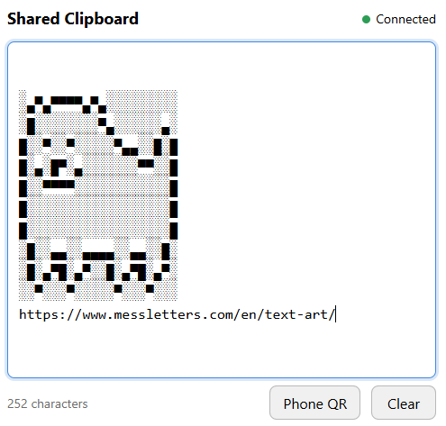

# Shared Clipboard

A small browser-based shared text area for devices on the same local network.
Run it on your computer, scan the QR code with your phone, and move text between
devices without signing into a service.



## Features

- Text updates sync between connected browsers over WebSockets.
- Scan **Phone QR** to open the same text area on another device.
- Responsive layout with light/dark mode, character count, and a shared Clear button.
- Disconnected browsers automatically try to reconnect.
- The server keeps the current text in memory; no database or account is required.

This shares text you type or paste into the page. It does **not** read or write
your operating system's clipboard automatically. Copy and paste using your
browser's normal controls.

## Run from source

Requires Python 3.9 or newer. Installing dependencies needs an internet
connection; afterward the app runs over your local network.

Download or clone this repository and open a terminal in its directory.

### Windows

Double-click **Start Shared Clipboard.bat**. On the first run it creates a local
`.venv` and installs both dependencies, then opens your browser.

Alternatively, set it up manually in PowerShell:

```powershell
python -m venv .venv
.\.venv\Scripts\python.exe -m pip install .
.\.venv\Scripts\python.exe shared_clipboard.py --open
```

### macOS / Linux

```sh
python3 -m venv .venv
.venv/bin/python -m pip install .
.venv/bin/python shared_clipboard.py --open
```

Open <http://localhost:8080> on the host computer. Click **Phone QR** and scan
it with your phone, or enter the **Phone/LAN** URL printed in the terminal.
Both devices must be on the same network. Keep the terminal open while using
the app; press **Ctrl+C** to stop it.

The installed package also provides the `shared-clipboard` command, available
after activating the virtual environment.

## Options

```sh
python shared_clipboard.py --help
python shared_clipboard.py --port 9090 --open
python shared_clipboard.py --host 127.0.0.1 --no-open
```

| Option | Default | Purpose |
| --- | --- | --- |
| `--host` | `0.0.0.0` | Listen on all IPv4 interfaces; use `127.0.0.1` for computer-only access. |
| `--port` | `8080` | Choose another port if the default is occupied. |
| `--open` | On | Open the computer's page in the default browser after the server starts. |
| `--no-open` | Off | Start the server without opening a browser. |

The Windows launcher accepts options too:

```powershell
& ".\Start Shared Clipboard.bat" --port 9090
```

The phone QR assumes LAN access is enabled. It cannot make a server bound to
`127.0.0.1` accessible to other devices.

## Build

### Windows executable

Create `.venv` using the setup commands above, then double-click
**Build Shared Clipboard.bat**. It installs build tools, runs the tests, builds
the Python distributions, and creates a fresh `dist/build-<timestamp>-<id>/`
folder containing the packages and `SharedClipboard.exe`. The build prints its
exact output path. Each run uses a new folder so old files or a running executable
do not need to be overwritten.

Open that output folder in PowerShell. The executable runs without a separate
Python installation:

```powershell
.\SharedClipboard.exe
.\SharedClipboard.exe --port 9090
.\SharedClipboard.exe --no-open
```

To run the same build manually:

```powershell
.\.venv\Scripts\python.exe -m pip install ".[build]"
.\.venv\Scripts\python.exe build_project.py
```

Build the executable on Windows. PyInstaller builds for the operating system
on which it runs. The console stays visible so you can read the connection URL
and stop the server with Ctrl+C. Double-clicking the executable starts the
server and opens the page in your default browser automatically. Use `--no-open`
to disable automatic browser opening; you can then visit <http://localhost:8080>.

### Python package

```sh
python -m pip install ".[build]"
python -m build --outdir dist/python-packages
```

This creates a wheel and a source archive in `dist/python-packages/`.
Use a fresh output directory if an older artifact is locked or has incompatible
Windows permissions. Use the Python executable
inside your virtual environment when it is not activated.

## How syncing works

One Python process serves the page, generates the QR code, and holds the current
text. Each browser opens a WebSocket connection and receives the current text
when it joins. Edits are sent after a short 100 ms pause and broadcast to all
connected browsers with an increasing revision number.

The most recently received update wins. This is a small text-transfer utility,
not a collaborative document editor: simultaneous edits can replace one
another. Text entered while disconnected may be replaced with the server's
current text when the browser reconnects.

## Network and privacy

Use this on a trusted local network. There is no login, and anyone who can
reach the server can view or replace the shared text. HTTP/WebSocket traffic is
unencrypted. Avoid sensitive text and do not expose the port to the internet.

The app does not intentionally save text to disk or send it to a cloud service.
Stopping the server clears its in-memory state; open browsers may still display
the last text. **Clear** empties the shared text for connected browsers.

## Troubleshooting

- **The phone cannot connect:** check that both devices share the same network.
  Guest networks may prevent devices from reaching one another. On Windows,
  allow Python or the executable through the firewall for your trusted private
  network.
- **The QR points to the wrong address:** VPNs or multiple network adapters can
  affect address detection. Find your Wi-Fi/Ethernet IPv4 address with `ipconfig`
  on Windows and enter `http://YOUR-IP:8080` on the phone (adjust the port if needed).
- **The port is in use:** start with `--port 9090`.
- **Python is missing:** install Python and reopen your terminal, then try again.
- **A package build reports `WinError 5`:** an older output file may be locked
  or have incompatible Windows permissions. The build launcher now uses a fresh
  output folder on every run. For a manual package build, choose a new `--outdir`.
- **Text disappears after restarting:** text is stored only in memory by design.

## Development and GitHub

```sh
python -m unittest discover -s tests -v
```

Integration tests cover serving the page and QR, syncing between browsers,
clearing text, late joins, malformed messages, and WebSocket origin checks.
GitHub Actions runs the checks on Windows and Linux and builds a downloadable
Windows executable artifact. Workflow artifacts are available from the
repository's **Actions** tab; they are not automatically published as releases.

Commit source files, documentation, and workflows. `.gitignore` excludes local
environments, generated packages, and executables. To share a compiled app,
attach `SharedClipboard.exe` to a GitHub Release.

## License

[MIT](LICENSE). Copyright (c) 2026 Ivan.
